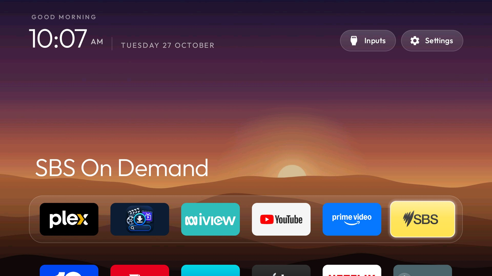

# bravia-speedup

Speeds up a Sony BRAVIA 4K VH2 (Google TV) by disabling bloat and swapping the ad-heavy home screen for
a lightweight one. Built on [cleanyourtv](https://github.com/Gathin23/cleanyourtv) (submodule in `vendor/`).



| Folder | What's in it |
|---|---|
| `lists/` | The debloat list for this TV (`vh2.txt`) |
| `launcher/` | Jim's settings for the replacement launcher, as a patch |
| `themes/` | The wallpaper theme the launcher uses |
| `results/` | Before/after speed measurements |
| `vendor/cleanyourtv/` | Upstream tools and launcher, pinned |

```sh
git clone --recurse-submodules <this repo>
TV_HOST=192.168.0.31 vendor/cleanyourtv/tools/disable.sh lists/vh2.txt
# undo:
TV_HOST=192.168.0.31 vendor/cleanyourtv/tools/restore.sh lists/vh2.txt com.google.android.apps.tv.launcherx
```

Nothing is uninstalled. `disable.sh` saves the TV's state to `~/.cleanyourtv/` first and `restore.sh` replays it.
See `results/` for before/after measurements.

## Launcher

`launcher/config.patch` holds Jim's settings for the cleanyourtv launcher: his dock apps, Sony's Live TV app,
no network button, hold-OK tile menu, and no focus bounce. To rebuild:

```sh
rsync -a vendor/cleanyourtv/launcher/ work/launcher/
patch -d work -p1 < launcher/config.patch
cd work/launcher && ./gradlew assembleRelease   # needs JDK 17 and the Android SDK (sdk.dir in local.properties)
adb -s 192.168.0.31:5555 install -r app/build/outputs/apk/release/app-release.apk
```

## Wallpaper

`themes/scenes/` puts 14 illustrated landscapes behind Home, a new one every hour, with a see-through dock.
The app-colour glow is off so the background stays the same as you move between apps. To push it again:

```sh
TV_HOST=192.168.0.31 vendor/cleanyourtv/tools/theme.sh themes/scenes
```

The first run needs the tools' venv: `python3 -m venv vendor/cleanyourtv/tools/venv && vendor/cleanyourtv/tools/venv/bin/pip install -r vendor/cleanyourtv/tools/requirements.txt`.
